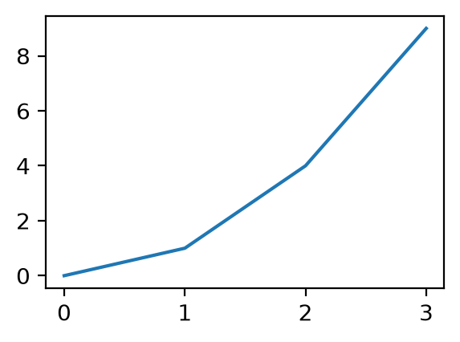
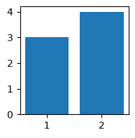

<!-- Generated by scireport <version> (template generic@1, layout default@1) from a bundle with manifest sha256 fa2d083d7ea2. Do not edit. -->

# Full-kinds report

**Every v1.0 kind**

N. Cardoso

Date: 2026-10-09 · Version: 1.0.0 · Pipeline: compat corpus · Keywords: compat, spec-1.0

A report that exercises **every** kind.

**Contents**

- [1 Text](#text)
- [2 Scalars](#scalars)
- [3 Collections](#collections)
- [4 Tables](#tables)
- [5 Figures](#figures)
- [6 Code and math](#code-and-math)
- [7 Status](#status)
- [8 References](#references)

## Text

Short **markdown** text.

A long paragraph. A long paragraph. A long paragraph. A long paragraph. A long paragraph. A long paragraph. A long paragraph. A long paragraph. A long paragraph. A long paragraph. A long paragraph. A long paragraph. A long paragraph. A long paragraph. A long paragraph. A long paragraph. A long paragraph. A long paragraph. A long paragraph. A long paragraph. A long paragraph. A long paragraph. A long paragraph. A long paragraph. A long paragraph. A long paragraph. A long paragraph. A long paragraph. A long paragraph. A long paragraph. A long paragraph. A long paragraph. A long paragraph. A long paragraph. A long paragraph. A long paragraph. A long paragraph. A long paragraph. A long paragraph. A long paragraph. A long paragraph. A long paragraph. A long paragraph. A long paragraph. A long paragraph. A long paragraph. A long paragraph. A long paragraph. A long paragraph. A long paragraph. A long paragraph. A long paragraph. A long paragraph. A long paragraph. A long paragraph. A long paragraph. A long paragraph. A long paragraph. A long paragraph. A long paragraph. A long paragraph. A long paragraph. A long paragraph. A long paragraph. A long paragraph. A long paragraph. A long paragraph. A long paragraph. A long paragraph. A long paragraph. A long paragraph. A long paragraph. A long paragraph. A long paragraph. A long paragraph. A long paragraph. A long paragraph. A long paragraph. A long paragraph. A long paragraph. A long paragraph. A long paragraph. A long paragraph. A long paragraph. A long paragraph. A long paragraph. A long paragraph. A long paragraph. A long paragraph. A long paragraph. A long paragraph. A long paragraph. A long paragraph. A long paragraph. A long paragraph. A long paragraph. A long paragraph. A long paragraph. A long paragraph. A long paragraph. A long paragraph. A long paragraph. A long paragraph. A long paragraph. A long paragraph. A long paragraph. A long paragraph. A long paragraph. A long paragraph. A long paragraph. A long paragraph. A long paragraph. A long paragraph. A long paragraph. A long paragraph. A long paragraph. A long paragraph. A long paragraph. A long paragraph. A long paragraph. A long paragraph. A long paragraph. A long paragraph. A long paragraph. A long paragraph. A long paragraph. A long paragraph. A long paragraph. A long paragraph. A long paragraph. A long paragraph. A long paragraph. A long paragraph. A long paragraph. A long paragraph. A long paragraph. A long paragraph. A long paragraph. A long paragraph. A long paragraph. A long paragraph. A long paragraph. A long paragraph. A long paragraph. A long paragraph. A long paragraph. A long paragraph. A long paragraph. A long paragraph. A long paragraph. A long paragraph. A long paragraph. A long paragraph. A long paragraph. A long paragraph. A long paragraph. A long paragraph. A long paragraph. A long paragraph. A long paragraph. A long paragraph. A long paragraph. A long paragraph. A long paragraph. A long paragraph. A long paragraph. A long paragraph. A long paragraph. A long paragraph. A long paragraph. A long paragraph. A long paragraph. A long paragraph. A long paragraph. A long paragraph. A long paragraph. A long paragraph. A long paragraph. A long paragraph. A long paragraph. A long paragraph. A long paragraph. A long paragraph. A long paragraph. A long paragraph. A long paragraph. A long paragraph. A long paragraph. A long paragraph. A long paragraph. A long paragraph. A long paragraph. A long paragraph. A long paragraph. A long paragraph. A long paragraph. A long paragraph. A long paragraph. A long paragraph. A long paragraph. A long paragraph. A long paragraph. A long paragraph. A long paragraph. A long paragraph. A long paragraph. A long paragraph. A long paragraph. A long paragraph. A long paragraph. A long paragraph. A long paragraph. A long paragraph. A long paragraph. A long paragraph. A long paragraph. A long paragraph. A long paragraph. A long paragraph. A long paragraph. A long paragraph. A long paragraph. A long paragraph. A long paragraph. A long paragraph. A long paragraph. A long paragraph. A long paragraph. A long paragraph. A long paragraph. A long paragraph. A long paragraph. A long paragraph. A long paragraph. A long paragraph. A long paragraph. A long paragraph. A long paragraph. A long paragraph. A long paragraph. A long paragraph. A long paragraph. A long paragraph. A long paragraph. A long paragraph. A long paragraph. A long paragraph. A long paragraph. A long paragraph. A long paragraph. A long paragraph. A long paragraph. A long paragraph. A long paragraph. A long paragraph. A long paragraph. A long paragraph. A long paragraph. A long paragraph. A long paragraph. A long paragraph. A long paragraph. A long paragraph. A long paragraph. A long paragraph. A long paragraph. A long paragraph. A long paragraph. A long paragraph. A long paragraph. A long paragraph. A long paragraph. A long paragraph. A long paragraph. A long paragraph. A long paragraph. A long paragraph. A long paragraph. A long paragraph. A long paragraph. A long paragraph. A long paragraph. A long paragraph. A long paragraph. A long paragraph. A long paragraph. A long paragraph. A long paragraph. A long paragraph. A long paragraph. A long paragraph. A long paragraph. A long paragraph. A long paragraph. A long paragraph. A long paragraph. A long paragraph. A long paragraph. A long paragraph. A long paragraph. A long paragraph. A long paragraph. A long paragraph. A long paragraph. A long paragraph. A long paragraph. A long paragraph. A long paragraph. A long paragraph. A long paragraph. A long paragraph. A long paragraph. A long paragraph. A long paragraph. A long paragraph. A long paragraph. A long paragraph. A long paragraph. A long paragraph. A long paragraph. A long paragraph. A long paragraph. A long paragraph. A long paragraph. A long paragraph. A long paragraph. A long paragraph. A long paragraph. A long paragraph. A long paragraph. A long paragraph. A long paragraph. A long paragraph. A long paragraph. A long paragraph. A long paragraph. A long paragraph. A long paragraph. A long paragraph. A long paragraph. A long paragraph. A long paragraph. A long paragraph. A long paragraph. A long paragraph. A long paragraph. A long paragraph. A long paragraph. A long paragraph. A long paragraph. A long paragraph. A long paragraph. A long paragraph. A long paragraph. A long paragraph. A long paragraph. A long paragraph. A long paragraph. A long paragraph. A long paragraph. A long paragraph. A long paragraph. A long paragraph. A long paragraph. A long paragraph. A long paragraph. A long paragraph. A long paragraph. A long paragraph. A long paragraph. A long paragraph. A long paragraph. A long paragraph. A long paragraph. A long paragraph. A long paragraph. A long paragraph. A long paragraph. A long paragraph. A long paragraph. A long paragraph. A long paragraph. A long paragraph. A long paragraph. A long paragraph. A long paragraph. A long paragraph. A long paragraph. A long paragraph. A long paragraph. A long paragraph. A long paragraph. A long paragraph. A long paragraph. A long paragraph. A long paragraph. A long paragraph. A long paragraph. A long paragraph. A long paragraph.

**Raw** LaTeX with $\alpha$

## Scalars

**Number:** 1.23 ± 0.01 arcsec

**Number interval:** 3,061 [3,000, 3,100]

**Number missing:** n/a

**Bool:** true

**Date:** 2026-10-09

## Collections

1. alpha
2. 2
3. false
4. - nested

- **Release:** 1.0.0
- **Rows:** 3061
- **Public:** true

## Tables

*Table 1. A Parquet table*

| ID | Redshift | label |
|---:|---:|:---|
| 1 | 0.100 | a |
| 2 | -- | b |
| 3 | 0.300 | c |

| a | b |
|---:|:---|
| 1 | x |
| 2 | y |

| check | result | Status |
|:---|:---|:---|
| nesting | ok | pass |
| sizes | FAILED | fail |

*Table 4. First rows only*

| n |
|---:|
| 0 |
| 1 |
| 2 |
| 3 |
| 4 |

*Showing the first 5 of 50 rows.* All rows: [all_rows.csv](attachments/all_rows.csv).

[all_rows.csv](attachments/all_rows.csv) — The 50 rows behind the cut table (142.0 B)

## Figures



*Figure 1. y = x squared*



## Code and math

$$
\int_0^\infty e^{-x^2}\,dx = \frac{\sqrt{\pi}}{2} \tag{1}
$$

```python
def f(x):
    return x * 2
```

*Doubling*

## Status

| Metric | Value | Detail |
|:---|---:|:---|
| Pairs | 3061 |  |
| Rate | 0.5 | of all |

> **PARTIAL:** PARTIALLY COMPLETE
>
> One stage was skipped.

> **ERROR:** A check failed.

1. **INGEST** (done) — 12 rows
2. **MATCH** (reused)
3. **PUBLISH** (done)

## References
